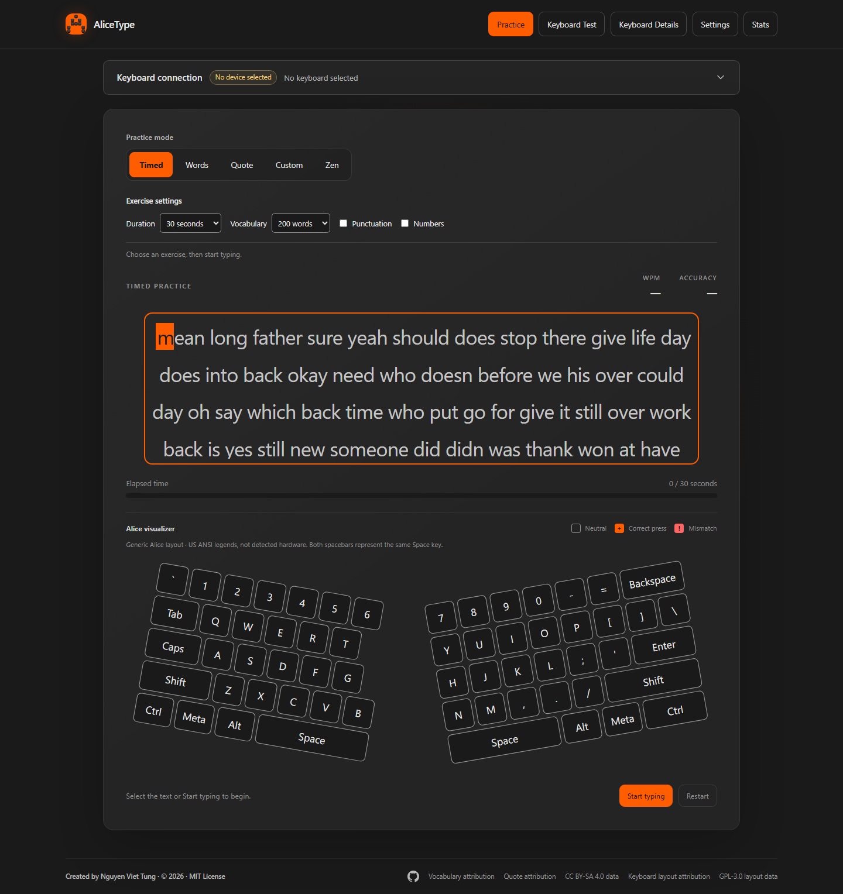

# AliceType

**Find your rhythm on an Alice keyboard.**

AliceType is a desktop-oriented typing practice app for Alice split-ergonomic
layouts. It runs entirely in your browser, with a charcoal interface, orange
accents, and real-time feedback.

[Open AliceType](https://alice-type.nguyenviettung.id.vn/) ·
[Technical design](doc/tech-design.md) ·
[Deployment workflow](.github/workflows/deploy-pages.yml)

[](https://github.com/nguyenviettung7691/alice-type/actions/workflows/deploy-pages.yml)
[](https://github.com/nguyenviettung7691/alice-type/stargazers)
[](https://github.com/nguyenviettung7691/alice-type/forks)
[](https://github.com/nguyenviettung7691/alice-type)
[](https://github.com/nguyenviettung7691/alice-type/commits/main)
[](https://github.com/xerj-org/xerj)



## Features

- Seven practice modes: Timed, Words, Quote, Custom, Zen, Alice Drills, and Code.
- An Alice keyboard visualizer, optional finger guide, and guided or Freestyle Keyboard Test.
- Keyboard Details with a generic Alice profile, sourced layout catalog, and optional VIA/Vial keymap import.
- Up to 20 local board profiles, four sourced geometry presets, and board-specific settings and history.
- English and Vietnamese interfaces and practice resources.
- Stats including missed-key summaries, per-key accuracy, adaptive drills, and setup-matched session insights.
- No accounts, backend, telemetry, or runtime data downloads.

Phase 12 features are implemented with automated verification. Real-board and
firmware checks, accessibility review, and fluent Vietnamese review remain
release gates. Browser events cannot identify a physical key when multiple keys
share a code or verify firmware layer activation. See the [Phase 12 plan](doc/phase-12-implementation-plan.md)
for details and outstanding checks.

## Quick start

Use **Node.js 24 LTS** and npm.

```sh
git clone https://github.com/nguyenviettung7691/alice-type.git
cd alice-type
npm ci
npm run dev
```

Open the local URL printed by Vite. Ordinary typing does not require keyboard or
device access.

| Command | Purpose |
| --- | --- |
| `npm run check` | Check Svelte and TypeScript |
| `npm test` | Run unit tests |
| `npm run build` | Build the production site in `dist/` |
| `npm run preview` | Preview the production build |
| `npm run test:e2e` | Run Chromium integration tests |
| `npm run import:layouts` | Regenerate the reviewed keyboard catalog (network required) |

Install Chromium before the first browser test run with
`npx playwright install chromium`. Browser tests start an isolated development
server and require port **4175** to be available.

## Practice and keyboard tools

Timed and Words offer 15–120 second or 10–100 word targets, with optional
punctuation and numbers. Quote offers English literary passages and original
Vietnamese practice passages. Custom lets you enter a target; Zen is free
writing; Alice Drills focus on split boundaries and hand alternation; Code
uses original Python, JavaScript, and Rust snippets.

Practice starts with the first committed input. It scores committed text rather
than provisional input-method composition, and supports Vietnamese text with
Unicode normalization. Composition and editing behavior can vary by browser
and operating system. Custom text, Zen writing, unfinished runs, and Keyboard
Test results are not saved.

Keyboard connection is optional. Browser-reported legends and device IDs are
not proof of a physical layout; a device-specific map is used only after you
confirm it. VIA/Vial keymap files are read locally, previewed, and applied only
after confirmation. AliceType does not read or write keyboard reports or
identify firmware layer activation.

Board profiles store user-provided hardware notes, layout choices, and
preferences. Switching boards is explicit; it does not happen automatically
when a device connects. Stats can be viewed for the active board, all boards,
unassigned older sessions, or a selected board.

## Data and privacy

Preferences and board profiles are stored in browser `localStorage`; completed
scores use IndexedDB. Data stays in the current browser and origin, is not
uploaded or synchronized, and may be removed by browser cleanup. Storage
failures are reported in the app. Keyboard Test counts and raw input events are
not stored.

## Deploy to GitHub Pages

1. In **Settings > Pages**, set the source to **GitHub Actions**.
2. Push to `main`, or run **Deploy to GitHub Pages** from the Actions tab.
3. Check the workflow's deployment URL after it succeeds.

The [deployment workflow](.github/workflows/deploy-pages.yml) installs locked
dependencies, checks the code, runs unit tests, and deploys the production
build. To preview a deployment-style build locally:

```sh
npm run build -- --base=./
npm run preview
```

## Design and roadmap

The [technical design](doc/tech-design.md) and phase-specific designs and
implementation plans in [`doc/`](doc/) describe the product contract, behavior,
verification, and remaining review gates.

## Data attribution and licensing

- **AliceType-authored code:** provisional [MIT license](LICENSE); confirm the
  copyright holder and licensing choice before publishing or distributing.
- **English and Vietnamese vocabulary:** FrequencyWords/OpenSubtitles2018
  snapshots under CC BY-SA 4.0. See the
  [license](src/lib/typing/word-banks/LICENSE-CC-BY-SA-4.0.txt) and
  [attribution notice](src/lib/typing/word-banks/NOTICE.txt).
- **Literary and Vietnamese passages:** see the
  [quote attribution and rights notice](src/lib/typing/QUOTE-NOTICE.txt).
- **Code snippets:** original AliceType material; see the
  [snippet notice](src/lib/typing/code-snippets/CODE-NOTICE.txt).
- **Keyboard layouts:** adapted from VIA and QMK under GPL-3.0; see the
  [license](src/lib/keyboard/layout-data/LICENSE-GPL-3.0.txt) and
  [layout notice](src/lib/keyboard/layout-data/NOTICE.txt).

AliceType-authored code remains MIT. Because the distributed build includes
GPL layout data, the build as a whole is conveyed under GPL-3.0; this public
repository provides the corresponding source.

### 🤖 AI Agent Reference

[](https://github.com/xerj-org/xerj)

The keyboard onboarding implementation (`feat: Enhance keyboard onboarding and connection experience`) in `alice-type` was selected for inclusion in the [XERJ Corpus Hub](https://github.com/xerj-org/xerj) — an open-source index providing AI coding agents with verified reference implementations.
