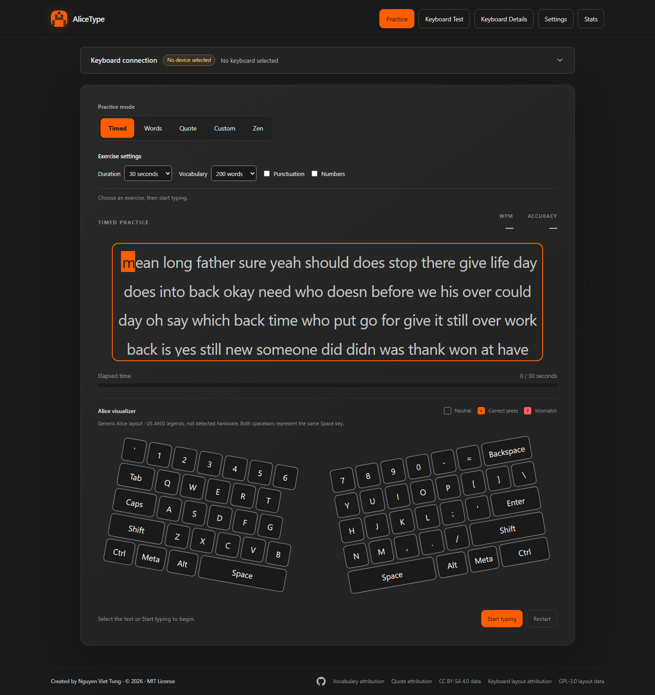

# AliceType

**Find your rhythm on an Alice keyboard.**

A desktop-oriented typing practice app for Alice split-ergonomic layouts.
Built with Svelte, TypeScript, and Vite, with a charcoal interface, an orange
accent, and real-time feedback. Everything runs in your browser.

[Open AliceType](https://alice-type.nguyenviettung.id.vn/) ·
[Technical design](doc/tech-design.md) ·
[Deployment workflow](.github/workflows/deploy-pages.yml)

[](https://github.com/nguyenviettung7691/alice-type/actions/workflows/deploy-pages.yml)



## At a glance

- **Five practice modes** with live feedback, WPM, accuracy, and progress.
- **Alice keyboard visualizer** with physical-key highlights and confirmed layout variants.
- **Keyboard Test** with guided and Freestyle modes, plus 13 optional synthesized sound effects.
- **Keyboard Details** with a generic Alice profile and 23 real Alice-family layouts sourced from QMK/VIA.
- **Local preferences and history** with missed-key summaries and separate Zen scores.
- **No accounts, backend, telemetry, or runtime data downloads.**

Phases 1-9 are implemented. Phase 10 implementation has started with localization
and Unicode input foundations. The current app is still English-only: the saved
language selector, complete Vietnamese resources, and native IME integration are
not yet available.
Difficulty rules, alternate themes, and reading
layouts from firmware are deferred. Browser-based automatic hardware
identification is not supported.

## Quick start

Use **Node.js 24 LTS** and npm, matching the deployment workflow.

```sh
git clone https://github.com/nguyenviettung7691/alice-type.git
cd alice-type
npm ci
npm run dev
```

Open the local URL printed by Vite. Ordinary typing works without granting
keyboard or device access.

### Development commands

| Command | Purpose |
| --- | --- |
| `npm run dev` | Start the development server |
| `npm run check` | Check Svelte and TypeScript |
| `npm test` | Run unit tests |
| `npm run build` | Create the production site in `dist/` |
| `npm run preview` | Preview the production build locally |
| `npm run test:e2e` | Run Chromium integration tests |
| `npm run import:layouts` | Regenerate the reviewed keyboard catalog; requires network access |

Install Chromium before the first browser test run:

```sh
npx playwright install chromium
npm run test:e2e
```

Browser tests start an isolated development server and require port **4175**
to be available. They cover practice modes, keyboard input, storage failures
and migrations, onboarding, audio, and desktop/narrow layouts.

## Practice

Select **Practice**, choose a mode, then select the exercise or activate
**Start typing**. Focusing does not start the timer; the first printable key does.

| Mode | How it works |
| --- | --- |
| **Timed** | Practice for 15, 30, 60, or 120 seconds. The target extends as needed; the default is 30 seconds. |
| **Words** | Complete 10, 25, 50, or 100 base words. |
| **Quote** | Copy one of 12 bundled literary passages, with author/work attribution. Restart repeats it; Next quote selects another while idle. |
| **Custom** | Paste or enter text, apply it, review the normalized preview, then start. Draft and target are limited to 10,000 characters. |
| **Zen** | Write freely without a target or limit. Stop explicitly to save a free-writing score; accuracy does not apply. |

Timed and Words offer **200**, **1000**, or **5000** word vocabularies, with
optional punctuation and numbers. Inactive choices are preserved across modes
but do not alter Quote or Custom text.

### Input and scoring

- Target-copying WPM uses currently correct characters, five characters per word.
  Accuracy counts all character attempts, including mistakes later corrected.
- Backspace removes the last character. Finite targets finish at their final
  position even if errors remain.
- Tab leaves practice capture; time continues while focus is elsewhere.
  **Resume typing** returns focus. Browser shortcuts are not captured.
- **Restart** discards an unfinished run and resets metrics. Navigation and
  settings stay locked while running; use Restart, or Stop in Zen, first.
- Practice accepts discrete printable ASCII key presses, not held-key repeat,
  composition/IME input, or pasted answers. Paste is available in the Custom
  editor only. Custom text normalizes whitespace and common typographic
  punctuation, and explicitly rejects unsupported characters.
- Zen suppresses live metrics, progress, keyboard visualization, and practice
  sounds without changing preferences. Its WPM uses retained characters;
  deleting text reduces the score. Only the trailing 2,000 characters are
  displayed, while earlier writing remains in memory for editing and scoring.

Custom text and Zen writing are never persisted. Restarting Zen, changing modes,
leaving Practice, or reloading releases its writing; leaving Practice, restoring
defaults, or reloading clears Custom text. Unfinished runs are not saved.

## Keyboard tools

### Visualizer and Keyboard Test

Practice highlights accepted physical keys in orange for a match or red for a
mismatch. Character correctness still depends on what you type, not the legend.
Both spacebars share the logical `Space` code. Narrow diagrams scroll horizontally.

In **Keyboard Test**, focus the test input and choose:

- **One key at a time:** follow the expected-key arrow. Correct keys show `+`;
  unexpected keys briefly show `!` without advancing. Cells do not show counts.
- **Freestyle:** press mapped keys in any order. Each cell shows its press count;
  there is no expected key, mismatch feedback, or completion.

Changing modes or restarting resets the matrix. Test results are temporary and
never contribute to practice history. Held-key repeat, composition, and system
shortcuts are ignored. **Shift+Tab** and **Escape** always leave capture.

Keyboard Test sound is independent of practice sound and defaults to off.
Its 13 effects are original synthesized interpretations, not downloaded recordings.

### Keyboard connection and layout matching

The collapsible connection panel offers optional browser keyboard legends and,
where supported in a secure context, WebHID device selection. WebHID requires an
explicit user gesture and may exclude protected keyboard interfaces. Skipping
access never blocks ordinary typing.

**Keyboard Details** separates catalog-verified facts, user-provided notes, and
unknown values. **Find my layout** ranks bundled catalog candidates using
browser-reported vendor/product IDs and an optional physical-key check. Shared
IDs are not proof of a match.

**A device-specific layout is used only after you confirm its profile and
variant.** Otherwise the generic Alice map remains active. Browser legends,
product names, and device IDs do not reliably identify physical geometry,
model, firmware, or hardware features. AliceType never opens HID devices or
reads/writes HID reports.

## Preferences, history, and privacy

The **Practice** page includes Block, Line, or Underline carets, live-stat
visibility, and optional generated typing clicks (off by default). **Restore
defaults** requires confirmation and does not delete history.

Preferences, selected profiles, confirmed layouts, and personal notes use
versioned `localStorage`. Completed scores use IndexedDB. **Stats** separates
target-copying WPM/accuracy and missed-key summaries from Zen free-writing scores.
Keyboard Test counts and raw input events are not stored.

All app data stays in your browser, with no uploads or remote synchronization.
Storage belongs to the current origin/browser and can be removed by browser
cleanup. Storage failures show explicit warnings and retry controls; reloading
discards unsaved pending results. Device grants can be revoked in browser site
settings.

## Deploy to GitHub Pages

1. In the repository's **Settings > Pages**, set **Build and deployment > Source**
   to **GitHub Actions**.
2. Push to `main`, or run **Deploy to GitHub Pages** manually from the Actions tab.
3. Check the workflow's deployment URL after it succeeds.

The [workflow](.github/workflows/deploy-pages.yml) installs locked dependencies
with `npm ci`, checks Svelte/TypeScript, runs unit tests, and builds the site.
It uploads `dist/` as a Pages artifact and deploys through the `github-pages`
environment using GitHub's built-in token; no personal access token is required.
Browser integration tests remain a separate local check.

The deployment build uses Vite's relative base (`./`) so asset URLs resolve from
the page location, both at `/alice-type/` and at the custom-domain root. This
avoids baking a repository path into the artifact that becomes invalid when a
custom domain is configured. Local development keeps Vite's default `/` base.
To preview the deployment build:

```sh
npm run build -- --base=./
npm run preview
```

Open the printed preview URL. After changing Pages domain settings, rerun the
deployment workflow to replace any older artifact built with an absolute base.
Changing the deployment origin does not migrate existing browser preferences or
history.

## Design and roadmap

The [technical design](doc/tech-design.md) is the product-level source of truth.
Each phase has a detail design and an implementation/verification plan:

| Phase | Scope | Documents |
| --- | --- | --- |
| 1 | Scaffolding and UI foundation | [Design](doc/phase-1-detail-design.md) · [Plan](doc/phase-1-implementation-plan.md) |
| 2 | Core typing engine | [Design](doc/phase-2-detail-design.md) · [Plan](doc/phase-2-implementation-plan.md) |
| 3 | Alice visualizer | [Design](doc/phase-3-detail-design.md) · [Plan](doc/phase-3-implementation-plan.md) |
| 4 | Modifiers, modes, and logic | [Design](doc/phase-4-detail-design.md) · [Plan](doc/phase-4-implementation-plan.md) |
| 5 | Storage and polish | [Design](doc/phase-5-detail-design.md) · [Plan](doc/phase-5-implementation-plan.md) |
| 6 | Keyboard Test matrix | [Design](doc/phase-6-detail-design.md) · [Plan](doc/phase-6-implementation-plan.md) |
| 7 | Keyboard Details and layout profiles | [Design](doc/phase-7-detail-design.md) · [Plan](doc/phase-7-implementation-plan.md) |
| 8 | Quote, Custom, and Zen | [Design](doc/phase-8-detail-design.md) · [Plan](doc/phase-8-implementation-plan.md) |
| 9 | Guided and Freestyle Keyboard Test modes | [Design](doc/phase-9-detail-design.md) · [Plan](doc/phase-9-implementation-plan.md) |
| 10 (in progress) | Extensible localization, Vietnamese UI/content and Unicode/IME practice, saved language selector | [Design](doc/phase-10-detail-design.md) · [Plan](doc/phase-10-implementation-plan.md) |

Phase 10 separates UI messages from practice word banks/content for each language.
Its planned far-right header selector will choose English or Vietnamese and save
that choice locally. The design includes Vietnamese input-method support and
history compatibility, rather than translating labels while leaving practice
ASCII-only. Existing input/scoring descriptions above describe the current
implemented app until Phase 10 is delivered.

The first implementation milestone adds a typed language/message registry,
initial English/Vietnamese message resources, locale formatting, shared
NFC/grapheme validation, and pure committed-edit reconciliation/scoring helpers.
The header now reads its labels from resources; it remains English in the app.
Vietnamese header switching is exercised only in a browser test fixture. The
new text helpers are not yet connected to Practice capture or stored scores.

## Data attribution and licensing

| Content | Source and terms |
| --- | --- |
| AliceType-authored source | Provisional [MIT license](LICENSE); confirm the copyright holder and licensing choice before publishing or distributing. |
| English vocabulary | Adapted from [FrequencyWords](https://github.com/hermitdave/FrequencyWords), derived from OpenSubtitles2018. [CC BY-SA 4.0](src/lib/typing/word-banks/LICENSE-CC-BY-SA-4.0.txt); see the [attribution and transformation notice](src/lib/typing/word-banks/NOTICE.txt). Tiers are source-frequency prefixes, not a universal ranking. |
| Literary passages | 12 passages across three works. See the [quote attribution and rights notice](src/lib/typing/QUOTE-NOTICE.txt) for editions, adaptations, and US public-domain status. Check local copyright law before redistribution outside the United States. |
| Keyboard layouts | Adapted from [VIA](https://github.com/the-via/keyboards) and [QMK](https://github.com/qmk/qmk_firmware) under [GPL-3.0](src/lib/keyboard/layout-data/LICENSE-GPL-3.0.txt). See the [notice](src/lib/keyboard/layout-data/NOTICE.txt) for pinned sources, modifications, and upstream notices. |

VIA supplies geometry and variants; QMK supplies default-keymap physical codes,
USB IDs, and manufacturer data. Maintainers regenerate the committed snapshot
from the reviewed [source allowlist](scripts/keyboard-layout-sources.json).
The app never fetches vocabulary, quotes, or layout data at runtime, and its
footer links to the bundled notices and licenses.

AliceType-authored code remains MIT. Because the distributed build includes
GPL layout data, the build as a whole is conveyed under GPL-3.0; this public
repository provides the corresponding source.
